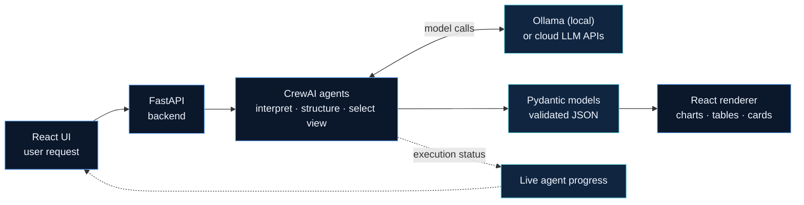

**I build web apps where an LLM is one part of a larger system:**
**a typed API in the middle, structured output on the wire, and a UI that renders it.**

[Featured project](#featured-project) · [Other projects](#other-projects) · [Stack](#tech-stack) · [Contact](#contact)

## What I work on

| Full-stack engineering | Applied AI | Generative UI |
| --- | --- | --- |
| React frontends connected to Python backends through explicit request/response contracts. | Multi-agent workflows, LLM integration, RAG, and automation that produce useful results, not just text. | Interfaces that choose and render charts, tables, and cards from structured model output. |

## Featured project

### Multi-Agent Generative UI Platform

Most AI apps answer with a paragraph. This one answers with the **right view for the data**: a chart, a table, or a statistics card.

**How it works**

1. The user sends a request from the React interface.
2. FastAPI receives it and starts the agent workflow.
3. CrewAI agents interpret the request, decide what data is needed, and select a visualization.
4. The result is validated against Pydantic models and returned as JSON.
5. React renders the matching component and shows agent progress in real time.

*Logical view of responsibilities and data flow.*

**Design ideas**

- **Contract first:** the agents' output is validated, so the UI never depends on free-form model text.
- **Model-agnostic:** the same workflow runs on local models (Ollama) or cloud APIs.
- **Honest failures:** incomplete results are handled explicitly and never shown as valid visualizations.
- **Visible progress:** users can watch the agents work instead of waiting on a spinner.

**Status:** in active development · **Repository:** coming soon

## Other projects

| Project | What it does | Status |
| --- | --- | --- |
| **MoboYab** | AI smartphone recommendations based on budget, preferences, and technical needs. | Repository coming soon |
| **Chat with Your Data** | Ask questions about your uploaded documents and datasets using retrieval-augmented generation (RAG). | Repository coming soon |

## Tech stack

| Area | Tools |
| --- | --- |
| Languages |  |
| Backend |   |
| Frontend |  |
| AI / LLM |   RAG · Cloud LLM APIs |
| Tools |   |

## Currently

Working on the contract between agent output and React rendering: checking schema consistency across local and cloud models, making agent progress easier to follow, and handling partial results safely.

## Contact

