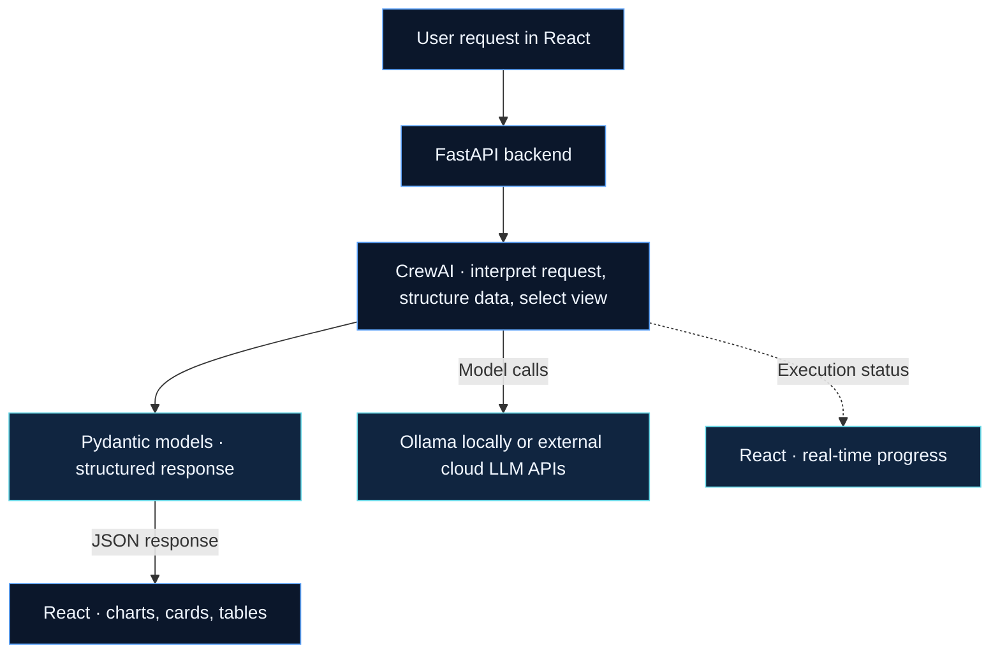

# Ali Noorian

**Full-stack engineering · Python · Applied AI systems**

I build web applications that use language models to solve practical problems. My focus is on what happens around the model: how the backend coordinates the work, how the API represents the result, and how the frontend turns that result into something a person can use.

[Projects](#featured-engineering-projects) · [Technical stack](#technical-stack) · [Contact](#professional-contact)

## Technical focus

- **Full-stack engineering:** Connecting React interfaces to Python backends through explicit request and response contracts.
- **Backend architecture and API design:** Separating request handling, model orchestration, output validation, and presentation so each layer can evolve independently.
- **Applied AI and automation:** Using LLMs for request interpretation, retrieval, and multi-step workflows where the result needs to be useful beyond a text reply.
- **Multi-agent systems and generative UI:** Assigning distinct responsibilities to agents and using structured results to drive charts, tables, and other interface components.

## Featured engineering projects

### Multi-Agent Generative UI Platform

A web application built with **CrewAI, FastAPI, and React**. Instead of returning only a text answer, it interprets a request, selects a suitable representation, and returns structured data that the frontend can render.

1. **Request and orchestration:** FastAPI handles the backend interface. Specialized CrewAI agents interpret the request, determine what information is needed and how it should be structured, then select a visualization.
2. **Model integration:** The workflow supports local models through Ollama and cloud-hosted models through external APIs.
3. **Response contract:** Pydantic models define the expected result structure; JSON carries the structured response to React.
4. **Rendering and progress:** React uses the response to render interactive charts, statistical cards, tables, or other data views. The frontend also shows agent execution progress in real time.

#### Architecture at a glance

The diagram shows logical responsibilities and data flow. It does not specify endpoint names, a model selection policy, or the transport used for progress updates.

### MoboYab

An AI-powered smartphone recommendation application. It takes a budget, user preferences, and technical requirements into account when suggesting suitable phones.

### Chat with Your Data

A Python application for asking questions about uploaded documents and datasets. It uses retrieval-augmented generation (RAG) to bring relevant information from the uploaded material into the model's context.

### [Kalayab](https://github.com/AliNoorian90/kalayab)

An experiment, not a production application. The public repository is currently empty.

## Technical stack

Technologies used in the projects described here:

- **Programming languages:** Python.
- **Frontend development:** React and schema-driven rendering of data views.
- **Backend development:** FastAPI and Pydantic.
- **AI and machine learning:** CrewAI for agent orchestration and RAG for document and dataset interactions.
- **LLM infrastructure:** Ollama for local model execution and external APIs for cloud-hosted models.
- **Databases and data handling:** JSON for API payloads; uploaded documents and datasets as retrieval inputs.
- **Development tools and automation:** GitHub for repository hosting and documentation. Workflow automation is an application focus.

## Engineering interests

- **Agent orchestration:** Choosing when specialized agents add value over a simpler workflow, and keeping responsibilities clear when a step fails.
- **Structured outputs and modular APIs:** Designing schemas that can be validated, tested, and extended without tightly coupling the UI to model output.
- **Human-in-the-loop systems:** Making progress visible and identifying which workflow decisions should require a person to review them.
- **Dynamic visualization and model integration:** Mapping result shapes to appropriate UI components, and evaluating how local and cloud models behave against the same response expectations.

## Current development

My current development focus is the multi-agent generative UI platform, particularly the contract between agent output and React rendering. I’m exploring how to evaluate schema consistency across model backends, make agent progress easier to understand, and handle incomplete results without presenting them as valid visualizations.

## Professional contact

[AliNoorian90 on GitHub](https://github.com/AliNoorian90). For a question about a public project, open an issue in its repository if issues are enabled and the question belongs there.
